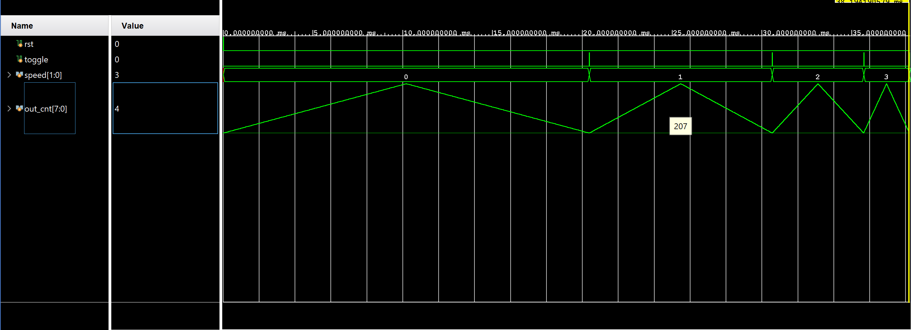
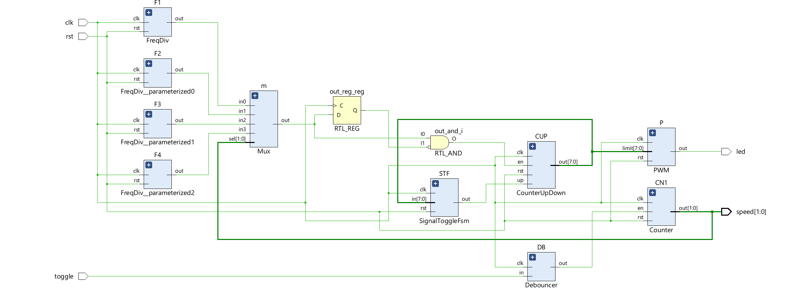
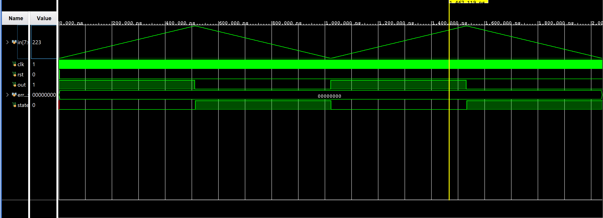
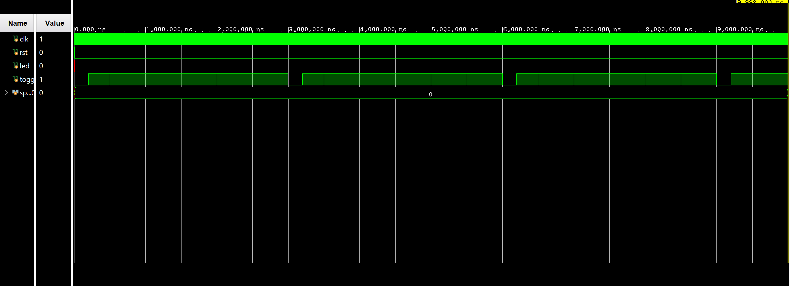

# Breathing LED Controller on FPGA (SystemVerilog)

A small, fully modular digital design that makes an LED **"breathe"**: it fades in and out smoothly, and a push button cycles between **4 breathing speeds**.
The design is written in synthesizable SystemVerilog, verified in simulation with self-checking testbenches and implemented on a Real Digital **Boolean Board** (Xilinx Spartan-7).



## About the project

A *breathing LED* is the slow, smooth fade-in / fade-out effect used on laptops, phones and smart-home devices to show a standby or "alive" state. An FPGA output pin can only be fully on or fully off, so the effect is produced with **pulse-width modulation (PWM)**: the LED is switched on and off hundreds of thousands of times per second, and the fraction of time it stays on (the *duty cycle*) sets the perceived brightness. Slowly sweeping the duty cycle up and down makes the LED appear to breathe.

The goal of the project was to build this effect as a complete, small digital system, from RTL to a bitstream, using only basic synchronous building blocks:

- **counters and clock dividers** to create slow time bases from a fast 100 MHz clock;
- a **finite-state machine** to control the counting direction;
- a **PWM generator** to convert a digital value into brightness;
- a **debouncer** to read a real, noisy push button.

Each block is a separate, reusable SystemVerilog module, and the top level is described purely **structurally** (only instances and wires), the same way larger chips are assembled from smaller verified blocks. The project covers the full FPGA flow: RTL design, testbenches and simulation, synthesis, place & route, timing analysis and bitstream generation.

### Behaviour on the board

- After reset (**BTN0**), **LED0** slowly brightens to full intensity and then dims back to off, continuously.
- Each press of **BTN1** makes the breathing **twice as fast**: one full breath takes about 5.1 s, 2.6 s, 1.3 s and 0.64 s for the four speeds. After the fastest speed it wraps around to the slowest one.
- **LED15–LED14** show the current speed in binary (00, 01, 10, 11).

## Features

- Parameterized **clock dividers** that generate 100 / 200 / 400 / 800 Hz from the 100 MHz board clock
- **Rising-edge detector** (D flip-flop + AND gate) that turns the selected clock into one-cycle enable pulses
- 8-bit **up/down counter** driven by a 2-state **Mealy FSM**, producing a 0 → 255 → 0 triangle wave
- 8-bit **PWM generator** that turns the counter value into LED brightness
- Push-button **debouncer** that outputs one pulse per press, and a 2-bit speed counter
- Self-checking testbench for the FSM, plus a scaled-down system testbench that measures the breathing period for every speed

## Block diagram

RTL schematic generated by Vivado from the SystemVerilog sources:



## How it works

1. **Speed selection.** Each press of `toggle` is debounced (the button must stay pressed for 6.5 ms) and turned into a single pulse that increments a 2-bit `Counter`. Its value, `speed` (shown on LED15 and LED14), selects one of the four divided clocks through the `Mux`.
2. **Step generation.** The selected clock is not used as a clock (which would create a new clock domain). Instead, a D flip-flop (`Reg`, written directly in `Top`) delays it by one cycle and the AND gate computes `in & ~in_delayed`. This produces a **one-cycle enable pulse on every rising edge**, keeping the whole design synchronous to the 100 MHz clock.
3. **Triangle wave.** On every pulse, `CounterUpDown` adds or subtracts 1. `SignalToggleFsm` watches the counter value and flips the direction **in the same clock cycle** in which the value reaches 255 (count down) or 0 (count up). The result is a continuous 0 → 255 → 0 ramp.
4. **Brightness.** `PWM` compares the ramp value with an internal 8-bit counter (0–255), so the duty cycle is `level / 256`. The PWM frequency is 100 MHz / 256 ≈ 390 kHz, much faster than the eye can see, so the LED appears to dim smoothly.

### Frequency divider parameters

`FreqDiv` toggles its output every `LIMIT` input cycles, so

$$f_{out} = \frac{f_{clk}}{2 \cdot LIMIT} \quad\Rightarrow\quad LIMIT = \frac{f_{clk}}{2 \cdot f_{out}}$$

| Speed | Output frequency | `LIMIT` (f_clk = 100 MHz) | Full breath (0→255→0) |
|:-:|:-:|:-:|:-:|
| 0 | 100 Hz | 500 000 | ≈ 5.1 s |
| 1 | 200 Hz | 250 000 | ≈ 2.6 s |
| 2 | 400 Hz | 125 000 | ≈ 1.3 s |
| 3 | 800 Hz | 62 500  | ≈ 0.64 s |

The values are computed in `Top` from the `CLK_FREQ` parameter, so the design can be retargeted to another board clock by changing a single number.

## Module reference

| Module | Ports | Function |
|---|---|---|
| `FreqDiv #(LIMIT)` | `clk`, `rst` → `out` | Counts `LIMIT` clock cycles and toggles `out`, giving a square wave of `f_clk / (2·LIMIT)`. The counter width is derived from `LIMIT` with `$clog2`, so every instance uses only as many flip-flops as it needs. |
| `Mux` | `in0..in3`, `sel[1:0]` → `out` | Combinational 4:1 multiplexer that selects one of the four divided clocks. |
| `Reg` + AND gate (in `Top`) | `out_mux` → `out_and` | D flip-flop that delays the selected signal by one cycle; `out_mux & ~out_reg` is high for exactly one clock cycle on each rising edge. |
| `CounterUpDown` | `clk`, `rst`, `en`, `up` → `out[7:0]` | 8-bit counter that adds 1 (`up = 1`) or subtracts 1 (`up = 0`) whenever `en` is high. Its value is the current brightness level. |
| `SignalToggleFsm` | `clk`, `rst`, `in[7:0]` → `out` | Two-state FSM (counting up / counting down). The output switches in the same cycle in which `in` reaches 255 or 0, so the counter never overflows or underflows. |
| `PWM` | `clk`, `rst`, `limit[7:0]` → `out` | Free-running 8-bit counter compared with `limit`; `out = (limit > counter)`, so the duty cycle is `limit / 256`. |
| `Debouncer #(limit)` | `clk`, `in` → `out` | Ignores contact bounce: the button must stay pressed for `limit` cycles (6.5 ms at 100 MHz) before a single one-cycle pulse is produced. Holding the button does not generate more pulses. |
| `Counter` | `clk`, `rst`, `en` → `out[1:0]` | 2-bit counter that stores the selected speed and wraps from 3 back to 0. |
| `Top` | `clk`, `rst`, `toggle` → `led`, `speed[1:0]` | Structural top level that instantiates and connects all the blocks above. |

## Design decisions

- **Single clock domain.** The divided signals are never used as clocks. Driving flip-flops from logic-generated clocks creates extra clock domains, skew and timing problems on an FPGA. Instead, every register runs on the 100 MHz board clock and the slow rates are turned into *enable* pulses by the edge detector. This is the standard, timing-safe way to build slow logic in a fast design.
- **Mealy output for the FSM.** The specification requires the direction to change in the *same* clock cycle in which the counter reaches 255 or 0. A Moore FSM (output depending only on the state) would react one cycle late, letting the counter wrap around from 255 to 0. The output is therefore computed from the current state **and** the input, while the state register updates on the next edge.
- **Parameterized design.** Divider limits are calculated in `Top` from `CLK_FREQ`, and the debounce time from `DEB_LIMIT`. Porting the design to a board with another oscillator means changing one parameter, and the same parameters are used to build a much faster simulation model (`tb_Top_fast`).
- **Synchronous, prioritized reset.** All counters use `if (rst) … else if (en) …`, so reset always wins over enable and the circuit starts from a known state.
- **Self-checking verification.** Instead of only inspecting waveforms by eye, the FSM testbench contains an independent reference model and reports `PASS`/`FAIL`, and the system testbench measures the ramp time for every speed and checks that the speed wraps around.

## Repository structure

```
rtl/
  Top.sv               structural top level (also contains the Reg flip-flop of the edge detector)
  FreqDiv.sv           parameterized clock divider
  Mux.sv               4:1 multiplexer
  CounterUpDown.sv     8-bit up/down counter with enable
  SignalToggleFsm.sv   direction-control FSM
  PWM.sv               8-bit PWM generator
  Debouncer.sv         button debouncer, one pulse per press
  Counter.sv           2-bit counter with enable
tb/
  tb_SignalToggleFsm.sv  self-checking FSM testbench (reference model)
  tb_Top.sv              top-level testbench (2 500 clock cycles)
  tb_Top_fast.sv         scaled-down system test: measures each speed
  *.wcfg                 Vivado waveform configurations
constraints/
  BooleanBoard.xdc
docs/                    Vivado simulation screenshots and RTL schematic
```

## Simulation

All waveforms below were captured in the Vivado simulator (XSim).

### FSM testbench

`tb_SignalToggleFsm` drives the input with a 0 → 255 → 0 ramp for 1 021 clock cycles and compares `out` with a reference model on every cycle. `out` drops in the same cycle in which `in` reaches 255 and rises again when `in` returns to 0; `state` follows one clock later (Mealy output).



### Top-level testbenches

- `tb_Top` applies the reset and a repeated button pattern for 2 500 clock cycles at the real parameters. This checks reset behaviour and connectivity; at 100 MHz the LED cannot visibly change in such a short window.



- `tb_Top_fast` instantiates `Top` with a 1 MHz clock and a short debounce delay, presses the button with simulated contact bounce, and measures one ramp for each speed. Every press halves the ramp time, and the speed wraps around to 0 after 4 presses:

```
speed=0  ramp 255->0 took 2550001 clock cycles
speed=1  ramp 255->0 took 1275001 clock cycles
speed=2  ramp 255->0 took 637501 clock cycles
speed=3  ramp 255->0 took 318751 clock cycles
PASS: speed wrapped around after 4 presses
```

### Running the simulations

With [Icarus Verilog](https://steveicarus.github.io/iverilog/):

```bash
make sim_fsm    # FSM testbench
make sim_top    # top-level testbench
make sim_fast   # scaled-down system test (takes under a minute)
```

The waveforms are written as `.vcd` files in `build/` and can be opened with GTKWave. In **Vivado**, add `rtl/` as design sources, `tb/` as simulation sources and choose the testbench as the simulation top.

## Implementation results

Vivado 2025.2, `xc7s50csga324-1`, 100 MHz clock constraint, after place & route:

| Metric | Value |
|---|---|
| Slice LUTs | 73 / 32 600 (0.22 %) |
| Slice registers | 115 / 65 200 (0.18 %) |
| I/O | 6 / 210 |
| Global clock buffers | 1 / 32 |
| Worst negative slack (setup) | **+5.467 ns** – timing met |
| Worst hold slack | +0.207 ns |
| Estimated Fmax | ≈ 1 / (10 ns − 5.467 ns) ≈ **220 MHz** |
| Total on-chip power | 0.075 W (0.003 W dynamic) |

## Running on the board (Boolean Board)

1. Create a Vivado project for the Boolean Board (`xc7s50csga324-1`), add `rtl/*.sv` and `constraints/BooleanBoard.xdc`, and set `Top` as the top module.
2. Run synthesis and implementation, generate the bitstream and program the board.

| Signal | Board |
|---|---|
| `clk` | 100 MHz oscillator |
| `rst` | BTN0 |
| `toggle` | BTN1 |
| `led` | LED0 |
| `speed[1:0]` | LED15, LED14 |

<!-- Add a photo or GIF of the board here, e.g. docs/demo.gif -->

## What I learned

- Writing synthesizable SystemVerilog (`always_ff`, `always_comb`, parameters, `$clog2`) and describing a design structurally from reusable modules.
- The difference between Mealy and Moore FSMs, and how the choice affects cycle-level timing.
- Why logic-generated clocks should be avoided and how enable pulses keep a design in one clock domain.
- Writing testbenches with `@(posedge clk)` and non-blocking assignments, scaling parameters to make long system behaviour simulate in seconds, and adding self-checks.
- The full Vivado flow: constraints (`.xdc`), synthesis, implementation, timing reports (setup/hold slack, Fmax), utilization and the device view.

## Possible extensions

- Gamma correction (lookup table) so the brightness change looks linear to the eye
- Drive an RGB LED with three phase-shifted ramps
- Show the current speed on the 7-segment display
- Run the RTL through an ASIC physical design flow (synthesis → place & route) and compare area and timing

## Author

**Roxana-Maria Constantinescu**, Computer Engineering student, University POLITEHNICA of Bucharest
[GitHub](https://github.com/Roxanacmaria) · [LinkedIn](https://www.linkedin.com/in/roxana-maria-constantinescu-92590a396/)
